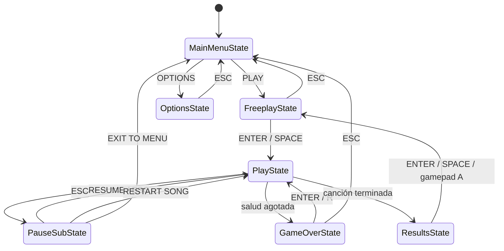
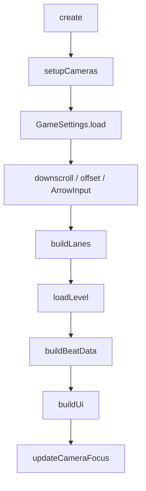
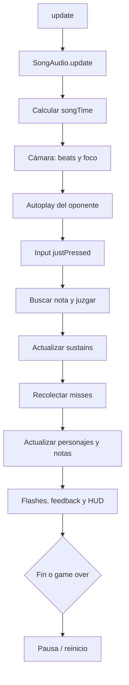

# DARK ENGINE

**Documentación técnica del motor de ritmo 4K**

> HaxeFlixel · charts FNF / Codename · audio multipista · holds · cámara dinámica · resultados

| Dato | Valor |
| --- | --- |
| Versión del proyecto | `0.1.0` |
| Runtime | Haxe 4 + HaxeFlixel 5 + OpenFL 9 + Lime 8 |
| Lienzo | `1280 x 720` |
| Objetivo | `60 FPS` con `FlxG.fixedTimestep = true` |
| Estado inicial | `MainMenuState` |
| Charts | FNF clásico y Codename `strumLines` |
| Personajes | Atlas Sparrow `PNG + XML` |
| Persistencia | `FlxG.save`, slot `DarkEngine` |
| Punto de entrada | `source/Main.hx` |

---

## Índice

1. [Panorama general](#panorama-general)
2. [Arquitectura](#arquitectura)
3. [Mapa de paquetes](#mapa-de-paquetes)
4. [Referencia de source](#referencia-de-source)
5. [Ciclo de PlayState](#ciclo-de-playstate)
6. [Formato de charts](#formato-de-charts)
7. [Formato Sparrow](#formato-sparrow)
8. [Opciones y persistencia](#opciones-y-persistencia)
9. [Controles](#controles)
10. [Juicios, puntaje y salud](#juicios-puntaje-y-salud)
11. [Cámara y HUD](#cámara-y-hud)
12. [Assets y mods](#assets-y-mods)
13. [Build y ejecución](#build-y-ejecución)
14. [Alcance actual](#alcance-actual)

---

## Panorama general

DarkEngine es un motor de ritmo 4K construido sobre HaxeFlixel. El flujo principal es:

```text
Menú principal -> Freeplay -> Gameplay -> Resultados
                       ^          |
                       |          +-> Pausa
                       |          +-> Game Over
                       +--------------+
```

**Capacidades implementadas**

- Navegación completa entre menú, freeplay, opciones, gameplay, pausa, game over y resultados.
- Descubrimiento automático de canciones con `meta.json`.
- Dos formatos de chart: FNF clásico por secciones y Codename por `strumLines`.
- Personajes y notas con atlas Sparrow.
- Audio separado en instrumental, voces del oponente y voces del jugador.
- Notas normales y sostenidas, juicios por ventana de tiempo, salud, puntaje y precisión.
- Cámara de juego con zoom rítmico cada 4 beats y paneo por sección.
- Controles reasignables, offset de notas y downscroll persistentes.
- HUD independiente de la cámara del mundo.

---

## Arquitectura

### Navegación entre estados



### Cadena de carga de una canción

```text
FreeplayState
  └─ PlayState(folder, difficulty)
       ├─ ChartLoader.loadSong(chart.json, meta.json)
       │    ├─ Assets.getText()
       │    ├─ FNFChartParser.parse()
       │    └─ meta: BPM, displayName, needsVoices
       ├─ SparrowCharacter(opponentCharacter)
       ├─ SparrowCharacter(playerCharacter)
       ├─ SparrowLoader(notes.png, notes.xml)
       ├─ buildChart()
       └─ SongAudio(Inst + Voices)
```

### Cámaras y capas en PlayState

| Capa | Contenido | Cámara |
| --- | --- | --- |
| Mundo | Personajes, receptores, etiquetas, notas, colas de sustain | `FlxG.camera` |
| HUD | Título, tiempo, score, salud, juicio, información, ayuda | `hudCamera` transparente |
| Audio | Instrumental y voces | Sin cámara; se sincroniza cada frame |

La cámara del HUD se agrega aparte para que el zoom y el paneo no deformen el texto ni la barra de salud.

---

## Mapa de paquetes

```text
source/
├── Main.hx
├── audio/
│   └── SongAudio.hx
├── chart/
│   ├── BpmChange.hx
│   ├── ChartLoader.hx
│   ├── ChartNote.hx
│   ├── ChartSection.hx
│   ├── ChartTimeMode.hx
│   ├── FNFChart.hx
│   └── FNFChartParser.hx
├── graphics/
│   ├── SparrowCharacter.hx
│   └── SparrowLoader.hx
├── input/
│   ├── ArrowInput.hx
│   └── NoteDirection.hx
├── notes/
│   ├── HitResult.hx
│   ├── Judgment.hx
│   ├── Note.hx
│   ├── NoteDetector.hx
│   └── TimingWindows.hx
├── settings/
│   └── GameSettings.hx
├── states/
│   ├── FreeplayState.hx
│   ├── GameOverState.hx
│   ├── MainMenuState.hx
│   ├── OptionsState.hx
│   ├── PauseSubState.hx
│   ├── PlayState.hx
│   └── ResultsState.hx
└── ui/
    └── HealthBar.hx
```

| Paquete | Responsabilidad | Depende de |
| --- | --- | --- |
| `source` | Arranque del `FlxGame` y estado inicial | `states` |
| `chart` | Modelo y parseo de charts; cambios de BPM y secciones | `input` |
| `graphics` | Carga de atlas Sparrow y personajes animados | `input` |
| `input` | Direcciones de nota y mapa de teclas | Flixel |
| `audio` | Reproducción, pausa y sincronización de pistas | Flixel |
| `notes` | Estado de notas, detección, ventanas y juicios | `input` |
| `settings` | Opciones persistentes del jugador | `input` |
| `states` | Pantallas y bucle principal del juego | Todos los anteriores |
| `ui` | Barra de salud reutilizable | Flixel |

---

## Referencia de source

### Boot

| Archivo | Clase | Responsabilidad | Claves | Relacionado |
| --- | --- | --- | --- | --- |
| `Main.hx` | `Main extends Sprite` | Punto de entrada; crea el juego y fija el timestep. | `GAME_WIDTH = 1280`<br>`GAME_HEIGHT = 720`<br>`TARGET_FPS = 60`<br>`new()` crea `FlxGame` con `MainMenuState`<br>`FlxG.fixedTimestep = true` | `MainMenuState` |

### chart

| Archivo | Clase | Responsabilidad | Claves | Relacionado |
| --- | --- | --- | --- | --- |
| `FNFChart.hx` | `FNFChart` | Modelo raíz de una canción ya parseada. | `songName`, `bpm`, `speed`, `offset`<br>`playerCharacter`, `opponentCharacter`<br>`sections`, `bpmChanges`, `notes`<br>`getPlayerNotes()`, `getOpponentNotes()` | `FNFChartParser`, `ChartLoader`, `PlayState` |
| `FNFChartParser.hx` | `FNFChartParser` | Normaliza JSON clásico o Codename a `FNFChart`. | `parse(json, timeMode?, fallbackBpm?)`<br>`parseStrumLines()`<br>`buildCameraSections()`<br>`convertTime()`<br>`compareNotes()` | `ChartLoader`, `ChartNote`, `ChartSection`, `BpmChange` |
| `ChartLoader.hx` | `ChartLoader` | Fachada de carga desde `Assets` y mezcla con `meta.json`. | `load(path, timeMode?)`<br>`loadSong(chartPath, metaPath?, timeMode?)`<br>`loadMeta()` | `FNFChartParser`, `openfl.utils.Assets` |
| `ChartNote.hx` | `ChartNote` | DTO de una nota del chart. | `time`, `direction`, `rawData`<br>`sustainLength`, `isPlayer`<br>`noteType`, `sectionIndex`<br>`getEndTime()` | `FNFChart`, `ChartSection`, `Note` |
| `ChartSection.hx` | `ChartSection` | Rango temporal y foco de una sección. | `index`, `startTime`, `endTime`<br>`bpm`, `changeBpm`, `mustHitSection`<br>`lengthInSteps`, `beats`<br>`altAnim`, `gfSection`, `notes`<br>`getDuration()` | `FNFChart`, `PlayState.currentSection()` |
| `BpmChange.hx` | `BpmChange` | Cambio de BPM ubicado en el tiempo. | `time`, `bpm`, `sectionIndex` | `FNFChart`, `PlayState.buildBeatData()` |
| `ChartTimeMode.hx` | `ChartTimeMode` | Modo de interpretación temporal de las notas. | `AbsoluteMs`<br>`SectionOffsetMs`<br>`SectionOffsetSteps`<br>`SectionOffsetBeats` | `FNFChartParser.convertTime()` |

### graphics

| Archivo | Clase | Responsabilidad | Claves | Relacionado |
| --- | --- | --- | --- | --- |
| `SparrowCharacter.hx` | `SparrowCharacter extends FlxSprite` | Carga un personaje Sparrow, sus animaciones y reacciones al cantar. | `CHARACTER_SCALE = 0.7`<br>`SING_HOLD_TIME = 0.36`<br>`characterName`, `isPlayer`, `isPlaceholder`<br>`sing()`, `updateCharacter()`<br>`placeAt()`, `playIdle()` | `SparrowLoader`, `PlayState` |
| `SparrowLoader.hx` | `SparrowLoader` | Carga segura de un atlas Sparrow. | `load(imagePath, xmlPath)`<br>Retorna `null` si falta un archivo o el XML es inválido. | `SparrowCharacter`, `PlayState` |

### input

| Archivo | Clase | Responsabilidad | Claves | Relacionado |
| --- | --- | --- | --- | --- |
| `ArrowInput.hx` | `ArrowInput` | Mapa de teclas por dirección y consultas de estado. | `bindings: Map<NoteDirection, Array<FlxKey>>`<br>`bind()`, `addBinding()`<br>`isPressed()`, `justPressed()`, `justReleased()`<br>`pressedDirections()`, `justPressedDirections()` | `GameSettings`, `PlayState` |
| `NoteDirection.hx` | `NoteDirection` | Enum abstract de las cuatro direcciones. | `LEFT = 0`<br>`DOWN = 1`<br>`UP = 2`<br>`RIGHT = 3`<br>`all()` | `ArrowInput`, `Note`, `ChartNote` |

### audio

| Archivo | Clase | Responsabilidad | Claves | Relacionado |
| --- | --- | --- | --- | --- |
| `SongAudio.hx` | `SongAudio` | Carga y coordina instrumental y voces. | `inst`, `opponentVoices`, `playerVoices`<br>`syncThreshold = 25`<br>`load()`, `loadSingleVoices()`<br>`play()`, `pause()`, `resume()`, `stop()`<br>`setPlayerVocalsMuted()`, `isFinished()` | `PlayState` |

### notes

| Archivo | Clase | Responsabilidad | Claves | Relacionado |
| --- | --- | --- | --- | --- |
| `Note.hx` | `Note` | Estado mutable de una nota durante la partida. | `time`, `direction`, `sustainLength`<br>`hit`, `judgment`<br>`sustainActive`, `sustainDropped`, `sustainCompleted`<br>`sustainLastTick`, `hasSustain()`, `getEndTime()` | `NoteDetector`, `PlayState` |
| `NoteDetector.hx` | `NoteDetector` | Busca la nota más cercana y decide el juicio. | `windows: TimingWindows`<br>`findClosestNote()`<br>`hitNote()`<br>`collectMissedNotes()`<br>`judge()` | `TimingWindows`, `HitResult`, `PlayState` |
| `TimingWindows.hx` | `TimingWindows` | Define y valida las ventanas de juicio. | Defaults: `45 / 90 / 135 / 180 ms`<br>`judgeOffset()`, `judge()`, `canHit()` | `NoteDetector`, `Judgment` |
| `Judgment.hx` | `Judgment` | Etiquetas de resultado. | `SICK`, `GOOD`, `BAD`, `SHIT`, `MISS`<br>`label()` | `PlayState`, `NoteDetector` |
| `HitResult.hx` | `HitResult` | Resultado de un intento de golpe. | `note`, `judgment`, `offset` | `NoteDetector`, `PlayState` |

### settings

| Archivo | Clase | Responsabilidad | Claves | Relacionado |
| --- | --- | --- | --- | --- |
| `GameSettings.hx` | `GameSettings` | Estado global y persistencia de controles y timing. | `leftKey`, `downKey`, `upKey`, `rightKey`<br>`noteOffsetMs`, `downscroll`<br>`load()`, `save()`, `getKey()`, `setKey()`<br>`setOffset()`, `setDownscroll()`, `resetToDefaults()` | `OptionsState`, `PlayState`, `ArrowInput` |

### states

| Archivo | Clase | Responsabilidad | Claves | Relacionado |
| --- | --- | --- | --- | --- |
| `MainMenuState.hx` | `MainMenuState` | Menú principal de dos opciones. | `MENU_ITEMS = ["PLAY", "OPTIONS"]`<br>`selected`, `menuTexts`<br>`moveSelection()`, `refreshMenu()` | `FreeplayState`, `OptionsState` |
| `FreeplayState.hx` | `FreeplayState` | Lista canciones y permite elegir dificultad e iniciar. | `SONG_ROOT = "assets/songs/"`<br>`MAX_VISIBLE_SONGS = 9`<br>`selectedSong`, `selectedDifficulty = 2`, `listOffset`<br>`discoverSongs()`, `buildEntry()`, `preferredDifficulty()` | `PlayState`, `MainMenuState` |
| `OptionsState.hx` | `OptionsState` | Edita binds, offset y downscroll. | `ROW_COUNT = 6`<br>`OFFSET_STEP = 5`, `OFFSET_FINE_STEP = 1`<br>`waitingForKey`, `selected`<br>`handleKeyCapture()`, `updateOffsetInput()` | `GameSettings`, `MainMenuState` |
| `PlayState.hx` | `PlayState` | Bucle principal de gameplay. | `chartData`, `songAudio`, `detector`, `notes`<br>`health`, `score`, juicios, `downscroll`<br>`create()`, `update()`, `loadLevel()`, `buildChart()`<br>`applyJudgment()`, `updateSustains()` | Todos los paquetes de juego |
| `PauseSubState.hx` | `PauseSubState` | Pausa el audio y muestra tres acciones. | `RESUME`, `RESTART SONG`, `EXIT TO MENU`<br>`selectedOption`<br>`pauseSong()`, `resumeSong()` | `PlayState`, `MainMenuState` |
| `ResultsState.hx` | `ResultsState` | Resume score, precisión, juicios y rango. | `songName`, `songDifficulty`, `score`, `accuracy`<br>`misses`, `sicks`, `goods`, `bads`, `shits`<br>`rankFor()`, `rankColor()`, `formatAccuracy()` | `FreeplayState` |
| `GameOverState.hx` | `GameOverState` | Pantalla de derrota con reintento. | `songFolder`, `songDifficulty`<br>`ENTER / R` reintenta<br>`ESC` vuelve al menú | `PlayState`, `MainMenuState` |

### ui

| Archivo | Clase | Responsabilidad | Claves | Relacionado |
| --- | --- | --- | --- | --- |
| `HealthBar.hx` | `HealthBar extends FlxGroup` | Barra de salud con fondo y relleno. | `BAR_WIDTH = 420`, `BAR_HEIGHT = 18`<br>`setHealth()`, `getHealth()`<br>`setCamera()`<br>`healthColor()` | `PlayState` |

---

## Ciclo de PlayState

### Construcción del estado



`PlayState` recibe `songFolder` y `songDifficulty`; si no se indican, usa `"emma"` y `"hard"`. La dificultad se normaliza a minúsculas.

| Paso | Acción |
| --- | --- |
| Cámaras | Crea `hudCamera` transparente y reinicia zoom/scroll del mundo. |
| Settings | Carga teclas, offset y downscroll. |
| Input | Crea `ArrowInput` y enlaza cada dirección con `GameSettings.getKey()`. |
| Lanes | Dibuja receptores, etiquetas de dirección y lado. |
| Nivel | Carga chart, personajes, atlas de notas, notas y audio. |
| Beats | Construye la grilla de beats para cámara. |
| HUD | Crea textos, barra de salud y mensajes de error. |
| Foco | Aplica el foco de cámara inicial. |

### Carga del nivel

```text
assets/songs/<folder>/charts/<difficulty>.json
assets/songs/<folder>/meta.json
assets/songs/<folder>/song/Inst.ogg
assets/songs/<folder>/song/Voices.ogg
      o
assets/songs/<folder>/song/Voices<OpponentSuffix>.ogg
assets/songs/<folder>/song/Voices<PlayerSuffix>.ogg
```

- `ChartLoader.loadSong()` parsea el chart y aplica `displayName`, `bpm` de respaldo y `needsVoices` desde `meta.json`.
- Los personajes se crean como `SparrowCharacter(chartData.opponentCharacter, false)` y `SparrowCharacter(chartData.playerCharacter, true)`.
- Las notas del jugador se guardan en `notes`; las del oponente en `opponentEntries`; ambas en `chart`.
- Si existe `Voices.ogg`, se carga como pista única de voces. Si no, se usan los sufijos declarados por el chart.
- Si faltan las voces, `loadLevel()` lanza una excepción; `create()` la captura y la muestra en el HUD con `loadError`.

### Bucle de actualización



El tiempo de canción se calcula así:

```haxe
rawSongTime = (songAudio != null && songAudio.isPlaying())
    ? songAudio.getTime()
    : elapsedSongTime;

songTime = rawSongTime + chartData.offset - noteOffsetMs;
```

| Etapa | Detalle |
| --- | --- |
| Audio | `SongAudio.update()` realinea voces si se desvían más de `25 ms`. |
| Offset | El offset del chart se suma; el offset del jugador se resta. |
| Cámara | Se actualiza antes del input y del render. |
| Oponente | Las notas del oponente se marcan como golpeadas al llegar su tiempo; se ocultan y se reproduce la animación. |
| Input | Solo se procesan teclas recién presionadas (`justPressedDirections()`). |
| Juicio | Se busca la nota más cercana de esa dirección dentro de `missWindow`. |
| Sustains | Se mantienen mientras la tecla siga presionada; se cortan al soltarla. |
| Misses | Después del input se recolectan las notas vencidas. |
| Render | Las notas se posicionan por tiempo; los receptores parpadean. |
| Fin | Al terminar el instrumental se entra a `ResultsState`. |
| Game over | Si `health <= 0` se detiene el audio y se entra a `GameOverState`. |

### Posicionamiento de notas

```text
Upscroll:
y = strumLineY - altura / 2 + (note.time - songTime) * 0.35

Downscroll:
y = strumLineY - altura / 2 - (note.time - songTime) * 0.35
```

- `NOTE_SPEED = 0.35` píxeles por milisegundo.
- `strumLineY = 50` en upscroll; `FlxG.height - 150` en downscroll.
- Las notas fuera de pantalla se ocultan, pero siguen existiendo hasta su juicio.
- La cola de un sustain se dibuja entre la posición de la nota y la posición de su tiempo final.

### Fin de canción

1. `resultsTriggered` evita dobles transiciones.
2. Toda nota del jugador sin golpear se marca como `MISS` y suma a `misses`.
3. Se detiene el audio.
4. Se calcula el peso de los juicios y la precisión.
5. Se cambia a `ResultsState` con score, precisión y conteos.

```text
weightedScore = sicks * 1.0 + goods * 0.75 + bads * 0.5 + shits * 0.25
accuracy      = weightedScore / totalPlayerNotes * 100
```

---

## Formato de charts

### Selección de formato

```text
JSON
├─ song.strumLines[] o root.strumLines[]  -> Codename
└─ song.notes[] / song.sections[]         -> FNF clásico
```

El parser revisa primero `strumLines`; si existe un arreglo, usa el flujo Codename y no intenta leer secciones clásicas.

### Chart FNF clásico

**Campos principales**

| Campo | Tipo | Default | Uso |
| --- | --- | --- | --- |
| `song.song` | string | `"Untitled"` | Nombre de la canción |
| `song.bpm` | number | requerido | BPM base; debe ser mayor que `0` |
| `song.speed` | number | `1` | Se guarda, pero el gameplay usa velocidad fija |
| `song.player1` | string | `"bf"` | Personaje del jugador |
| `song.player2` | string | `"dad"` | Personaje del oponente |
| `song.gfVersion` | string | `"gf"` | Se guarda; no se renderiza actualmente |
| `song.stage` | string | `"stage"` | Se guarda; no se renderiza actualmente |
| `song.needsVoices` | bool | `true` | Se guarda |
| `song.offset` | number | `0` | Offset del chart en milisegundos |

**Sección**

| Campo | Tipo | Default | Uso |
| --- | --- | --- | --- |
| `mustHitSection` | bool | `false` | Determina qué lado canta y el foco de cámara |
| `changeBPM` | bool | `false` | Habilita el cambio de BPM de la sección |
| `bpm` | number | BPM actual | Nuevo BPM si `changeBPM` es verdadero |
| `lengthInSteps` | int | `16` | Pasos de la sección |
| `sectionBeats` | number | `lengthInSteps / 4` | Duración en beats |
| `altAnim` | bool | `false` | Se guarda |
| `gfSection` | bool | `false` | Se guarda |
| `sectionNotes` | array | vacío | Notas de la sección |

**Nota de sección**

```json
[tiempo, dato, sustain, "tipo"]
```

| Índice | Campo | Uso |
| --- | --- | --- |
| `0` | `time` | Tiempo según `ChartTimeMode` |
| `1` | `data` | `lane = data % 4`; además define el lado |
| `2` | `sustain` | Duración del hold en milisegundos |
| `3` | `type` | Opcional; se convierte a string |

**Dirección:** `data % 4` produce `0 LEFT`, `1 DOWN`, `2 UP`, `3 RIGHT`.

**Lado:** `isPlayer = (mustHitSection == (data < 4))`.

```text
mustHitSection = true   -> data 0..3 = jugador, data 4..7 = oponente
mustHitSection = false  -> data 0..3 = oponente, data 4..7 = jugador
```

**Ejemplo mínimo**

```json
{
  "song": {
    "song": "Example",
    "bpm": 150,
    "speed": 2,
    "player1": "bf",
    "player2": "dad",
    "needsVoices": true,
    "offset": 0,
    "notes": [
      {
        "mustHitSection": true,
        "sectionBeats": 4,
        "sectionNotes": [
          [1000, 0, 0],
          [1500, 5, 250, "alt"]
        ]
      }
    ]
  }
}
```

### Chart Codename

**Campos principales**

| Campo | Tipo | Default | Uso |
| --- | --- | --- | --- |
| `strumLines` | array | requerido | Líneas de notas por lado |
| `songName` / `song` | string | `"Untitled"` | Nombre interno |
| `bpm` | number | `0` si falta | BPM base |
| `scrollSpeed` / `speed` | number | `1` | Se guarda, pero no cambia la velocidad fija |
| `stage` | string | `"stage"` | Se guarda |
| `needsVoices` | bool | `true` | Se guarda |
| `offset` | number | `0` | Offset del chart |

**StrumLine**

| Campo | Tipo | Uso |
| --- | --- | --- |
| `position` | string | `bf`, `boyfriend`, `player` o `both` = jugador; `dad` u `opponent` = oponente |
| `characters` | array | El primer nombre se usa como personaje |
| `vocalsSuffix` | string | Sufijo del archivo de voces, por ejemplo `-emma` |
| `notes` | array | Notas de la línea |

**Nota**

| Campo | Tipo | Uso |
| --- | --- | --- |
| `id` | int | `id % 4` define la dirección |
| `time` | number | Tiempo absoluto en milisegundos |
| `sLen` | number | Duración del sustain en milisegundos |
| `type` | string/number | Se guarda como `noteType`; no cambia el gameplay |

**Ejemplo mínimo**

```json
{
  "codenameChart": true,
  "scrollSpeed": 2.5,
  "events": [
    {
      "time": 5051.02,
      "name": "Camera Movement",
      "params": [1, true, 4, "CLASSIC", "In"]
    }
  ],
  "strumLines": [
    {
      "position": "dad",
      "vocalsSuffix": "-math",
      "characters": ["math"],
      "notes": [
        { "id": 1, "time": 0, "sLen": 0, "type": 0 }
      ]
    },
    {
      "position": "boyfriend",
      "vocalsSuffix": "-emma",
      "characters": ["emma"],
      "notes": [
        { "id": 0, "time": 5051.02, "sLen": 0, "type": 0 }
      ]
    }
  ]
}
```

### Modos de tiempo

| Modo | Fórmula |
| --- | --- |
| `AbsoluteMs` | `time = rawTime` |
| `SectionOffsetMs` | `time = sectionStart + rawTime` |
| `SectionOffsetSteps` | `time = sectionStart + rawTime * (60000 / bpm / 4)` |
| `SectionOffsetBeats` | `time = sectionStart + rawTime * (60000 / bpm)` |

`ChartLoader` usa `AbsoluteMs` por defecto si no se indica un modo.

### BPM y secciones

- Si hay un BPM válido, el parser agrega un `BpmChange` inicial en `time = 0`.
- En charts clásicos, un cambio se agrega al inicio de la sección donde aparece `changeBPM`.
- La duración de una sección se calcula con `60000 / bpm * sectionBeats`.
- Si no hay `sectionBeats`, se usan `lengthInSteps / 4` beats.
- `PlayState` genera la grilla de beats desde `bpmChanges`; si no existen, usa `chart.bpm`.

### Eventos `Camera Movement`

Cuando el chart usa el flujo clásico, el parser lee `events` desde `root` o desde `song` y acepta eventos cuyo `name` sea exactamente `"Camera Movement"`.

| Parámetro | Uso |
| --- | --- |
| `params[0]` | `0` = foco del oponente; `1` = foco del jugador; acepta bool o número |
| `time` | Tiempo absoluto del cambio |
| Resto de parámetros | Ignorados por el motor |

Comportamiento actual:

- Los eventos se convierten en `ChartSection` sintéticas.
- Si el primer evento ocurre después de `0`, se crea una sección inicial con foco del oponente.
- El último evento se extiende hasta el final del chart o hasta cuatro beats después, el mayor valor.
- La síntesis se ejecuta al final del flujo de charts clásicos y las secciones resultantes se agregan después de las secciones originales.
- En charts Codename con `strumLines`, el parser retorna antes y `PlayState` usa ventanas de respaldo basadas en densidad de notas. Ver [Cámara y HUD](#cámara-y-hud).

---

## Formato Sparrow

### Atlas de personaje

`assets/images/characters/<name>.png` + `assets/images/characters/<name>.xml`

```xml
<?xml version="1.0" encoding="utf-8"?>
<TextureAtlas imagePath="emma.png">
  <SubTexture
    name="emma idle0000"
    x="1077" y="0"
    width="335" height="639"
    frameX="-228" frameY="-109"
    frameWidth="768" frameHeight="768" />
</TextureAtlas>
```

Las animaciones se construyen con `animation.addByPrefix()` usando el nombre de cada frame.

### Metadata de personaje

`assets/data/characters/<name>.xml`

```xml
<!DOCTYPE codename-engine-character>
<character camx="-150" color="#F8A2E3">
  <anim name="idle" anim="emma idle" fps="24" loop="true" />
  <anim name="singLEFT" anim="emma left" />
  <anim name="singDOWN" anim="emma down" />
  <anim name="singUP" anim="emma up" />
  <anim name="singRIGHT" anim="emma right" />
</character>
```

| Atributo | Uso |
| --- | --- |
| `character.flipX` | Si es `"true"`, invierte el sprite |
| `character.antialiasing` | Si es `"false"`, desactiva antialiasing |
| `anim.name` | Nombre interno de la animación |
| `anim.anim` | Prefijo de frames en el atlas |
| `anim.fps` | FPS; default `24` |
| `anim.loop` | `"true"` o ausente = loop; `"false"` = una vez |

Sin metadata, el personaje usa estas animaciones por defecto:

| Animación | Prefijo | FPS | Loop |
| --- | --- | --- | --- |
| `idle` | `<name> idle` | 24 | sí |
| `singLEFT` | `<name> left` | 24 | sí |
| `singDOWN` | `<name> down` | 24 | sí |
| `singUP` | `<name> up` | 24 | sí |
| `singRIGHT` | `<name> right` | 24 | sí |

- `flipX` por defecto es `isPlayer`.
- Al cantar, si el personaje está volteado, `LEFT` y `RIGHT` intercambian animación.
- La animación de canto se mantiene `0.36 s` y luego vuelve a `idle`.
- Si falta el atlas, el personaje se reemplaza por un rectángulo `180 x 360`.

### Atlas de notas

```text
assets/images/notes/notes.png
assets/images/notes/notes.xml
```

| Dirección | Frame |
| --- | --- |
| `LEFT` | `noteLEFT0000` |
| `DOWN` | `noteDOWN0000` |
| `UP` | `noteUP0000` |
| `RIGHT` | `noteRIGHT0000` |

Si el atlas falta o no contiene el frame, se usa un rectángulo `56 x 24` con el color de la dirección.

| Dirección | Color |
| --- | --- |
| `LEFT` | `0xFFC24B99` |
| `DOWN` | `0xFF00CFFF` |
| `UP` | `0xFF12FA05` |
| `RIGHT` | `0xFFF9393F` |

---

## Opciones y persistencia

### Claves guardadas

`GameSettings` usa `FlxG.save.bind("DarkEngine", "DarkEngine")` y `FlxG.save.flush()`.

| Clave | Campo estático | Tipo | Default | Pantalla |
| --- | --- | --- | --- | --- |
| `optionsLeftKey` | `leftKey` | `FlxKey` | `LEFT` | LEFT KEY |
| `optionsDownKey` | `downKey` | `FlxKey` | `DOWN` | DOWN KEY |
| `optionsUpKey` | `upKey` | `FlxKey` | `UP` | UP KEY |
| `optionsRightKey` | `rightKey` | `FlxKey` | `RIGHT` | RIGHT KEY |
| `optionsNoteOffsetMs` | `noteOffsetMs` | `Float` | `0` | NOTE OFFSET |
| `optionsDownscroll` | `downscroll` | `Bool` | `false` | DOWNSCROLL |

### Reglas

- Los binds se cargan una sola vez por proceso mediante `loaded`.
- Si la tecla nueva ya pertenece a otra dirección, las teclas se intercambian.
- Cada cambio de tecla, offset o downscroll se guarda inmediatamente.
- `R` en Options restaura todos los valores por defecto.
- El offset se redondea y se limita a `-300..300 ms`.
- En Options, `IZQUIERDA/DERECHA` ajustan `5 ms`; con `SHIFT` ajustan `1 ms`.
- `ENTER` sobre NOTE OFFSET reinicia el valor a `0 ms`.
- Un offset positivo retrasa las notas respecto al audio.

### Filas de Options

| Fila | Acción |
| --- | --- |
| `LEFT KEY` | Captura una tecla nueva |
| `DOWN KEY` | Captura una tecla nueva |
| `UP KEY` | Captura una tecla nueva |
| `RIGHT KEY` | Captura una tecla nueva |
| `NOTE OFFSET` | Ajusta o reinicia el offset |
| `DOWNSCROLL` | Activa o desactiva el scroll descendente |

Durante la captura, `ESC` cancela el cambio sin cerrar la pantalla.

---

## Controles

### Navegación

| Contexto | Acción | Tecla |
| --- | --- | --- |
| Menú principal | Mover selección | `UP` / `DOWN` |
| Menú principal | Confirmar | `ENTER` / `SPACE` |
| Freeplay | Mover canción | `UP` / `DOWN` |
| Freeplay | Cambiar dificultad | `LEFT` / `RIGHT` |
| Freeplay | Jugar | `ENTER` / `SPACE` |
| Freeplay | Volver | `ESC` |
| Options | Mover selección | `UP` / `DOWN` |
| Options | Rebind / confirmar | `ENTER` / `SPACE` |
| Options | Ajustar offset | `LEFT` / `RIGHT` |
| Options | Restaurar defaults | `R` |
| Options | Volver | `ESC` |
| Pausa | Mover selección | `UP` / `DOWN` |
| Pausa | Confirmar | `ENTER` / `SPACE` |
| Pausa | Reanudar | `ESC` |
| Game Over | Reintentar | `ENTER` / `R` |
| Game Over | Volver al menú | `ESC` |
| Resultados | Volver a Freeplay | `ENTER` / `SPACE` / gamepad `A` |

### Gameplay

| Acción | Tecla |
| --- | --- |
| Carril izquierdo | `leftKey` (default `LEFT`) |
| Carril abajo | `downKey` (default `DOWN`) |
| Carril arriba | `upKey` (default `UP`) |
| Carril derecho | `rightKey` (default `RIGHT`) |
| Pausa | `ESC` |
| Reiniciar canción | `R` |

El input de gameplay solo usa `justPressed`; mantener una tecla no genera golpes repetidos. Los sustains sí consultan `isPressed` cada frame.

---

## Juicios, puntaje y salud

### Ventanas

| Juicio | Ventana | Peso | Score | Salud |
| --- | --- | --- | --- | --- |
| `SICK` | `<= 45 ms` | `1.0` | `+350` | `+0.035` |
| `GOOD` | `<= 90 ms` | `0.75` | `+200` | `+0.015` |
| `BAD` | `<= 135 ms` | `0.5` | `+100` | `0` |
| `SHIT` | `<= 180 ms` | `0.25` | `+50` | `-0.02` |
| `MISS` | fuera de ventana / nota vencida | `0` | `0` | `-0.05` |

- La salud inicial es `0.5` y siempre se limita a `0..1`.
- `MISS` no puede obtenerse al presionar una tecla dentro de `missWindow`; se asigna cuando la nota vence o al terminar la canción.
- Si la salud llega a `0`, el audio se detiene y se entra a `GameOverState`.

### Feedback visual

| Juicio | Color |
| --- | --- |
| `SICK` | `0xFF00E5FF` |
| `GOOD` | `0xFF22FF44` |
| `BAD` | `0xFFFFAA00` |
| `SHIT` | `0xFFB36BFF` |
| `MISS` | `0xFFFF3344` |

El texto muestra el juicio y el offset en milisegundos con signo. Permanece visible `0.8 s` y se desvanece.

### Sustains

| Evento | Score | Salud |
| --- | --- | --- |
| Tick cada `50 ms` | `+10` | `+0.0025` |
| Completar hasta el final | Sin bono extra | — |
| Soltar antes del final | `0` | `-0.035` |

- Se inicia un sustain solo si el golpe inicial no fue `MISS`.
- Mientras la dirección siga presionada, se acumulan ticks.
- Al cortar un hold se muestra `HOLD CUT`, se reproduce el feedback y se silencian temporalmente las voces del jugador.
- Al completar o cortar, la cola deja de renderizarse.

### Voces

- `MISS` o `SHIT`: se silencian las voces del jugador.
- `SICK` o `GOOD`: se restauran.
- Un hold cortado también silencia las voces del jugador.

### Precisión y rango

```text
accuracy = (SICK * 1.0 + GOOD * 0.75 + BAD * 0.5 + SHIT * 0.25)
           / totalNotasDelJugador * 100
```

| Rango | Precisión |
| --- | --- |
| `S` | `>= 95` |
| `A` | `>= 85` |
| `B` | `>= 75` |
| `C` | `>= 65` |
| `F` | `< 65` |

`ResultsState` recibe score, precisión y los conteos. También muestra la dificultad y permite volver a Freeplay.

### Barra de salud

| Rango | Color |
| --- | --- |
| `>= 0.5` | `0xFF33DD66` |
| `> 0.25` y `< 0.5` | `0xFFFFCC33` |
| `<= 0.25` | `0xFFFF3344` |

El relleno escala horizontalmente de `0` a `1`. La barra mide `420 x 18 px`.

---

## Cámara y HUD

### Cámara del mundo

| Efecto | Valor |
| --- | --- |
| Zoom base | `1.0` |
| Zoom por bump (cada 4 beats) | `+0.025` |
| Entrada del zoom | `0.06 s`, `quadOut` |
| Salida del zoom | `0.16 s`, `quadIn` |
| Beats por bump | `4` |
| Desplazamiento por foco | `FlxG.width * 0.06 = 76.8 px` |
| Duración del paneo | `0.45 s`, `cubeInOut` |

**Grilla de beats**

- Se construye desde `chartData.bpmChanges`.
- Cada cambio válido genera beats hasta el siguiente cambio de BPM o el final del chart.
- Si no hay cambios, se usa `chartData.bpm` desde `0` hasta el final del chart.
- `addBeatTime()` descarta beats separados por menos de `0.5 ms`.

**Foco horizontal**

- Con secciones: se usa `section.mustHitSection` de la sección activa.
- Foco del jugador: `scroll.x = +76.8`.
- Foco del oponente: `scroll.x = -76.8`.
- Sin secciones y con BPM válido: se generan ventanas de respaldo cada cuatro beats.
- En las ventanas de respaldo, se cuentan notas del jugador y del oponente; gana el lado con más notas y, en empate, se conserva el foco anterior.
- `currentFocusKey` evita repetir el tween si el foco no cambió.

> **Nota de implementación:** los charts Codename con `strumLines` no generan `ChartSection` desde los eventos `Camera Movement`; usan las ventanas de respaldo. En charts clásicos, las secciones sintéticas se agregan después de las secciones originales, por lo que `currentSection()` todavía resuelve el foco con las secciones clásicas. En ambos casos, el foco efectivo actual no está controlado por los eventos.

### Cámara del HUD

- `hudCamera` tiene fondo transparente y se agrega como cámara independiente.
- El zoom y el scroll del mundo no afectan textos ni barra de salud.
- `HealthBar.setCamera()` asigna la cámara a todos los miembros del grupo.
- `destroy()` elimina la cámara del HUD y restaura zoom/scroll del mundo.

### Layout del HUD

| Elemento | Upscroll | Downscroll |
| --- | --- | --- |
| Título | `y = 24`, tamaño `28` | `y = 4`, tamaño `22` |
| Tiempo | `y = 28`, alineado a la derecha | igual |
| Salud | `y = 650` | `y = 40` |
| Score | `y = 625` | `y = 75` |
| Juicio | `y = 100`, tamaño `44` | igual |
| Info del chart | `y = 156` | igual |
| Ventanas | `y = 180` | igual |
| Error de carga | `y = 216` | igual |
| Ayuda | `y = height - 32` | igual |

### Layout del gameplay

| Elemento | Valor |
| --- | --- |
| Centro del grupo oponente | `width * 0.28` |
| Centro del grupo jugador | `width * 0.72` |
| Ancho de carril | `110 px` |
| Receptores | `64 x 64 px` |
| Color receptor jugador | `0xFF2A2A45` |
| Color receptor oponente | `0xFF1E1E30` |
| Flash de receptor | `0xFFB8B8FF` durante `0.12 s` |
| Y de personajes | `96` |
| Alpha de nota del oponente | `0.5` |
| Alpha de nota del jugador | `1.0` |
| Alpha de sustain jugador | `0.6` |
| Alpha de sustain oponente | `0.3` |

---

## Assets y mods

`Project.xml` monta los assets del mod en rutas virtuales:

| Origen | Ruta virtual |
| --- | --- |
| `mods/Emma's Road - TAT UST/songs` | `assets/songs` |
| `mods/Emma's Road - TAT UST/images/characters` | `assets/images/characters` |
| `mods/Emma's Road - TAT UST/data/characters` | `assets/data/characters` |
| `assets/images/notes` | `assets/images/notes` |

### Estructura de una canción

```text
mods/
└── Emma's Road - TAT UST/
    ├── songs/
    │   └── emma/
    │       ├── meta.json
    │       ├── charts/
    │       │   └── hard.json
    │       └── song/
    │           ├── Inst.ogg
    │           ├── Voices-emma.ogg
    │           └── Voices-math.ogg
    ├── images/
    │   └── characters/
    │       ├── emma.png
    │       ├── emma.xml
    │       ├── math.png
    │       └── math.xml
    └── data/
        └── characters/
            ├── emma.xml
            └── math.xml
```

### Meta

```json
{
  "displayName": "emma",
  "bpm": 196,
  "needsVoices": true,
  "stepsPerBeat": 4,
  "beatsPerMeasure": 4,
  "difficulties": ["hard"]
}
```

Campos consumidos actualmente por el motor:

- `displayName`: nombre visible en Freeplay y en el HUD.
- `bpm`: BPM de respaldo si el chart no lo declara.
- `needsVoices`: se copia a `FNFChart`.

Los demás campos se conservan en el archivo, pero no alteran el gameplay.

### Descubrimiento en Freeplay

- Recorre `Assets.list()` buscando rutas bajo `assets/songs/`.
- Solo considera carpetas que tengan `meta.json`.
- Ordena las carpetas alfabéticamente sin distinguir mayúsculas.
- Detecta disponibilidad de `easy.json`, `normal.json` y `hard.json`.
- Muestra como máximo `9` canciones a la vez.
- Al entrar, elige la dificultad más alta disponible de la primera canción.

### Dificultades

| Índice | Archivo | Etiqueta |
| --- | --- | --- |
| `0` | `easy.json` | `EASY` |
| `1` | `normal.json` | `NORMAL` |
| `2` | `hard.json` | `HARD` |

Si se intenta jugar una dificultad sin chart, Freeplay muestra un error y no cambia de estado.

---

## Build y ejecución

### Requisitos

- Haxe 4.
- Lime.
- HaxeFlixel (declarado como `<haxelib name="flixel" />`).
- Un target soportado por Lime, por ejemplo HashLink o HTML5.

### Compilación

```bash
lime build hl
lime build html5
```

El target HTML5 genera la salida en `bin/html5/bin/`.

Para probarlo localmente, sirve esa carpeta con un servidor estático:

```bash
cd bin/html5/bin
python -m http.server 8765
```

Luego abre `http://127.0.0.1:8765/index.html`.

### Assets en runtime

Todas las rutas del código usan la raíz virtual `assets/`. No se leen rutas del sistema directamente; Lime resuelve los archivos según `Project.xml`.

---

## Alcance actual

| Área | Estado |
| --- | --- |
| Menú principal | Implementado |
| Freeplay con 3 dificultades | Implementado |
| Charts FNF clásicos | Implementado |
| Charts Codename `strumLines` | Implementado |
| Personajes Sparrow | Implementado |
| Notas y sustains | Implementado |
| Audio multipista y sincronización | Implementado |
| Pausa, game over y resultados | Implementado |
| Controles, offset y downscroll persistentes | Implementado |
| Cámara con zoom y foco | Implementado |
| Fondo de escenario (`stage`) | Parseado, no renderizado |
| Personaje `gfVersion` | Parseado, no renderizado |
| Tipos de nota (`noteType`) | Parseados, sin efecto |
| Velocidad de scroll por chart | Parseada; el gameplay usa `0.35` fijo |
| Eventos de cámara | Se parsean; el foco efectivo usa secciones clásicas o respaldo, no los eventos |
| Gameplay con gamepad | No implementado; solo `A` en Results |
| Guardado de scores e historial | No implementado |
| Editor de charts | No incluido |

### Limitaciones conocidas

- El motor es exclusivamente 4K.
- No hay countdown ni pantalla de carga de canción.
- No se cargan fondos de escenario ni animaciones de girlfriend.
- Las animaciones de canto dependen de que los prefijos existan en el atlas.
- La cámara usa solo desplazamiento horizontal; no hay zoom por sección ni efectos personalizados de eventos.
- La precisión se calcula al finalizar; no se guarda en `FlxG.save`.
